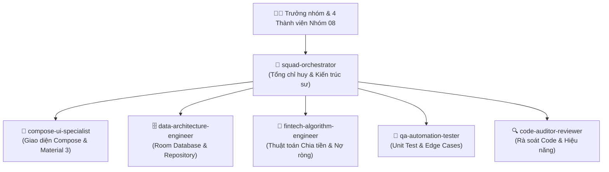

# 🤖 HỆ THỐNG ĐỘI NGŨ AGENT TĂNG NĂNG SUẤT (AI AGENT SQUAD)
**Dự án:** Ứng dụng Quản lý Chi tiêu Cá nhân & Nhóm (SpendTogether)  
**Nhóm sinh viên thực hiện:** Nhóm 08 (Lớp D23CQCI01-N)  
**Nền tảng:** Android (Kotlin, Jetpack Compose, Material 3, Room Database)

---

## 1. Mục Tiêu & Cơ Chế Hoạt Động Của Đội Ngũ Agent
Để hỗ trợ và nhân đôi năng suất làm việc cho **4 thành viên** của Nhóm 08 trong suốt lộ trình 4 tuần phát triển ứng dụng, hệ thống bổ sung một **Đội ngũ 6 AI Agent chuyên trách (Specialized AI Squad)**. 

Mỗi Agent đảm nhiệm một chuyên môn sâu, làm việc độc lập hoặc phối hợp nhịp nhàng (Pair Programming) với từng thành viên nhằm đảm bảo:
- 🚀 **Tốc độ:** Rút ngắn thời gian viết code giao diện và logic dữ liệu.
- 🎯 **Chính xác:** Đảm bảo thuật toán chia tiền và tối ưu nợ không có sai số.
- 🛡️ **Chất lượng:** Độ bao phủ kiểm thử cao, không có lỗi crash, giao diện mượt mà đạt chuẩn nghiệm thu đồ án.

---

## 2. Danh Sách & Chuyên Môn Của 6 AI Agent Đã Thiết Lập

| Tên Subagent | Vai Trò & Chuyên Môn | Công Cụ & Thư Viện Trọng Tâm |
| :--- | :--- | :--- |
| **`squad-orchestrator`** | **Tổng chỉ huy & Solution Architect**: Phân rã task từ 8 tính năng, phân bổ cho các agent kỹ thuật, kiểm soát tiến độ theo tuần và hợp nhất module. | Clean Architecture, Git branch sync, Sprint Planning |
| **`compose-ui-specialist`** | **Kỹ sư Giao diện Jetpack Compose**: Xây dựng UI/UX hiện đại, responsive, Material 3, animations chuyển cảnh, custom canvas vẽ biểu đồ. | Jetpack Compose, Material 3, Canvas, Navigation Compose |
| **`data-architecture-engineer`** | **Kỹ sư Dữ liệu & Persistence**: Thiết kế Entities, DAOs, Room Database, StateFlow, Repository Pattern, TypeConverters. | Room DB, SQLite, Coroutines, StateFlow, DataStore |
| **`fintech-algorithm-engineer`** | **Kỹ sư Thuật toán Tài chính**: Cài đặt thuật toán chia tiền (Equal, Percent, Custom) và thuật toán tối ưu hóa công nợ (Min Cash Flow / Graph Matching). | Kotlin Algorithms, BigMath, Graph Simplification |
| **`qa-automation-tester`** | **Kỹ sư Kiểm thử Tự động**: Viết Unit Tests kiểm tra tính toán tiền, test Room in-memory DB, validation form và Compose UI Test. | JUnit 4/5, Mockk, ComposeTestRule, Truth/AssertJ |
| **`code-auditor-reviewer`** | **Chuyên gia Rà soát & Tối ưu**: Kiểm tra Kotlin convention, phát hiện recomposition thừa, chống leak memory, chuẩn bị tài liệu báo cáo đồ án. | Android Profiler, Lint Rules, KDoc Documentation |

---

## 3. Ma Trận Phối Hợp Giữa Đội Ngũ Agent Và 4 Thành Viên

Đội ngũ Agent được phân bổ trực tiếp tương ứng với 8 tính năng trong bản kế hoạch đồ án:

| Thành viên nhóm 08 | Tính năng phụ trách | AI Agent phụ trách đồng hành | Nhiệm vụ AI Agent thực hiện |
| :--- | :--- | :--- | :--- |
| **Lê Văn Hùng** *(Trưởng nhóm)* | **1. Đăng nhập & Đăng ký** *(Auth)* **2. Quản lý Thành viên** *(Member CRUD)* | `compose-ui-specialist` `data-architecture-engineer` | - Tạo UI Login/Register/Forgot Pass đẹp mắt. - Lưu User Session / DataStore. - Thiết kế MemberEntity, MemberDao và màn hình danh sách thành viên + BottomSheet thêm mới. |
| **Lý Việt Linh** | **3. Quản lý Khoản Chi** *(Expense CRUD)* **4. Quản lý Khoản Thu & Quỹ** *(Income & Budget)* | `compose-ui-specialist` `data-architecture-engineer` | - Tạo Form nhập tiền, bàn phím số, chọn ngày & category. - Thiết kế ExpenseEntity & BudgetEntity. - Logic kiểm tra hạn mức ngân sách chi tiêu hàng tháng. |
| **Nguyễn Phan Tấn Đạt** | **5. Tự Tính Chia Tiền** *(Expense Splitting)* **6. Quyết Toán & Nhắc Nợ** *(Settlement)* | `fintech-algorithm-engineer` `qa-automation-tester` | - Cài đặt thuật toán chia đều, chia %, xử lý đồng lẻ. - Thuật toán bù trừ nợ thông minh (giảm thiểu số lần chuyển tiền). - Viết 100% Unit Test cho các ca nợ phức tạp. |
| **Lê Trung Bình** | **7. Lịch Sử & Bộ Lọc** *(History & Filter)* **8. Báo Cáo & Biểu Đồ** *(Analytics Charts)* | `compose-ui-specialist` `fintech-algorithm-engineer` `code-auditor-reviewer` | - Viết Flow Query lọc nhiều tiêu chí (ngày, tháng, thành viên, danh mục). - Dựng Canvas vẽ biểu đồ tròn (Pie Chart) & cột (Bar Chart). - Tối ưu hóa recomposition khi render biểu đồ. |

---

## 4. Quy Trình Vận Hành Mẫu (End-to-End Workflow)

Khi triển khai một tính năng mới (ví dụ: **Tính năng 5 & 6 - Chia tiền và Quyết toán nợ**):

1. **Bước 1 (Đặc tả & Phân rã):** `squad-orchestrator` phân tích yêu cầu từ `KeHoachPhanCong_DoAn_QuanLyChiTieu.docx`.
2. **Bước 2 (Lập trình Thuật toán):** `fintech-algorithm-engineer` hiện thực hóa hàm `calculateEqualSplit()` và `simplifyDebts()`.
3. **Bước 3 (Kiểm thử Logic):** `qa-automation-tester` chạy bộ test tự động kiểm thử 10 kịch bản chia tiền và đồ thị nợ.
4. **Bước 4 (Dữ liệu & Persistence):** `data-architecture-engineer` cập nhật Room DAO để lưu trữ các bảng quyết toán nợ.
5. **Bước 5 (Giao diện Jetpack Compose):** `compose-ui-specialist` vẽ màn hình danh sách nợ với thẻ hiển thị người trả, người nhận và nút "Xác nhận trả nợ".
6. **Bước 6 (Audit & Nghiệm thu):** `code-auditor-reviewer` rà soát code, dọn dẹp import, tối ưu recomposition và xuất tài liệu giải thích.

---

## 5. Hướng Dẫn Sử Dụng Trong Chat Session

Để kích hoạt bất kỳ Agent nào, người dùng có thể yêu cầu trực tiếp trong chat. Ví dụ:
- *"Hãy cho `compose-ui-specialist` thiết kế màn hình Login và Register với Material 3."*
- *"Hãy giao cho `fintech-algorithm-engineer` viết thuật toán tối ưu hóa nợ ròng Min Cash Flow và cho `qa-automation-tester` viết unit test."*
- *"Hãy yêu cầu `data-architecture-engineer` tạo Room Database cho Member và Expense."*
- Hoặc sử dụng slash command `/teamwork-preview` để khởi chạy phiên phối hợp tự động đa agent!
