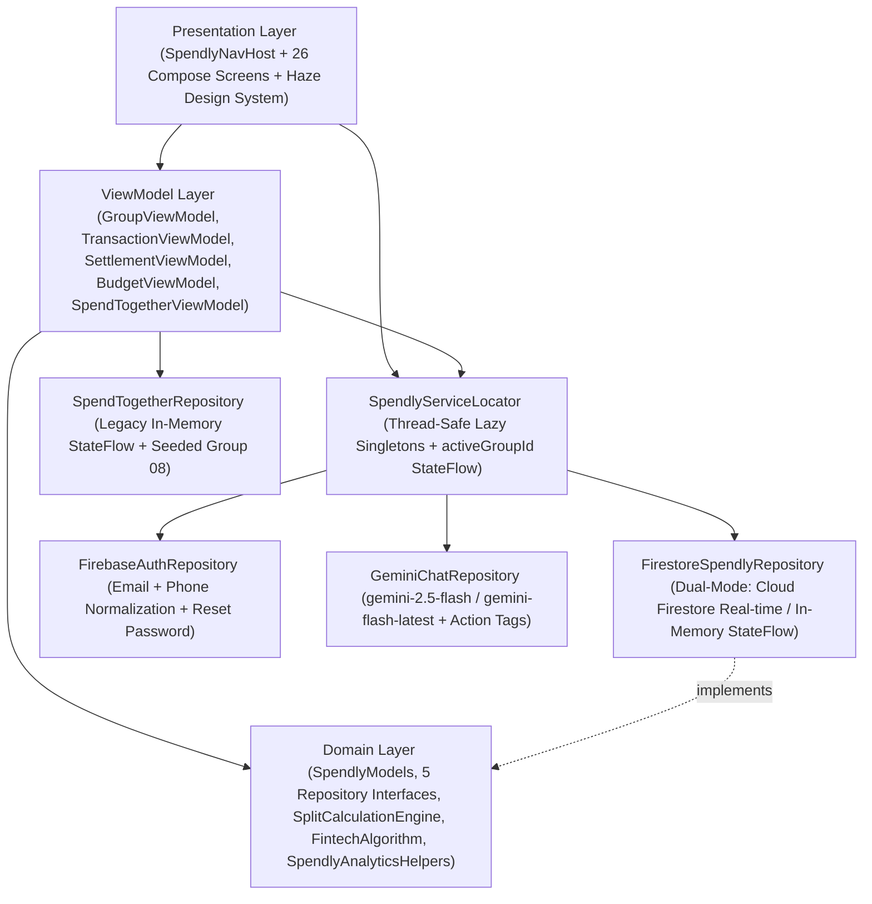

# BÁO CÁO TỔNG HỢP NGỮ CẢNH DỰ ÁN — SPENDLY (NHÓM 08)

> **Tài liệu nén toàn bộ ngữ cảnh kỹ thuật, kiến trúc, dữ liệu, thuật toán, kiểm thử và hiện trạng triển khai** của dự án **Spendly** (tên giai đoạn đầu/tài liệu: **SpendTogether**; `rootProject.name = "Nhoms 8"`).  
> **Cập nhật theo mã nguồn hiện tại:** 20/11/2026 | **Vị trí dự án:** thư mục con `demo-app-PTUD-main/`

---

## 1. Thông Tin Chung & Chỉ Số Dự Án

| Hạng mục | Giá trị xác thực từ mã nguồn & tài liệu |
| :--- | :--- |
| **Tên ứng dụng hiển thị** | `Spendly` (`app/src/main/res/values/strings.xml`) |
| **Tên trong tài liệu / giai đoạn đầu** | `SpendTogether` (`README.md`, `SpendTogetherViewModel`, `SpendTogetherRepository`) |
| **Tên project Gradle & Package** | `rootProject.name = "Nhoms 8"` · `applicationId = "com.example.nhoms8"` |
| **Đồ án môn học** | Phát triển Ứng dụng (`PTUD`) — **Nhóm 08**, lớp **D23CQCI01-N** |
| **Quy mô nhóm & lộ trình** | 04 thành viên, lộ trình 4 tuần (Tuần 1: Thiết kế & Model → Tuần 2: Dev độc lập → Tuần 3: Tích hợp → Tuần 4: Kiểm thử & Báo cáo) |
| **Mã nguồn chính (`:app/src/main`)** | **62 file `.kt`**, tổng **38.978 dòng** |
| **Kiểm thử đơn vị (`:app/src/test`)** | **12 file test**, **2.635 dòng**, **61 `@Test` cases** |
| **Kiểm thử thiết bị (`:app/src/androidTest`)** | **1 file** (`ExampleInstrumentedTest.kt`, 663 bytes) |
| **Số màn hình (`*Screen*.kt`)** | **28 file màn hình** (**26 màn hình** đang nối trong `SpendlyNavHost`, **2 màn hình V1** chưa nối: `CreateExpenseScreen.kt`, `SplitBillScreen.kt`) |
| **Module `:lib`** | **8 file `.kt`** bài tập Kotlin console (`BaiTap1_TongChan.kt`, `BaiTap2_LonThuHai.kt`, `MyClass.kt`, `test.kt`–`test5.kt`) + `r.bat` |
| **Tổng quan Firebase Project** | `project_id: app-quan-ly-chi`, `project_number: 719905091520` (`app/google-services.json`) |

### Phân công 4 thành viên ↔ 8 tính năng gốc ↔ AI Squad (`KeHoachPhanCong_DoAn_QuanLyChiTieu.docx` & `AGENTS.md`)

| Thành viên | Vai trò | 2 Tính năng phụ trách | AI Agent đồng hành trong `AGENTS.md` |
| :--- | :--- | :--- | :--- |
| **Lê Văn Hùng** | Trưởng nhóm | **1.** Đăng nhập, Đăng ký, Quên MK (`Auth`)<br>**2.** Quản lý Thành viên (`Member CRUD`) | `compose-ui-specialist`, `data-architecture-engineer` |
| **Lý Việt Linh** | Thành viên | **3.** Quản lý Khoản Chi (`Expense CRUD`)<br>**4.** Quản lý Khoản Thu & Quỹ (`Income & Budget`) | `compose-ui-specialist`, `data-architecture-engineer` |
| **Nguyễn Phan Tấn Đạt** | Thành viên | **5.** Tự Tính Chia Tiền (`Expense Splitting`)<br>**6.** Quyết Toán & Nhắc Nợ (`Settlement`) | `fintech-algorithm-engineer`, `qa-automation-tester` |
| **Lê Trung Bình** | Thành viên | **7.** Lịch Sử & Bộ Lọc (`History & Filter`)<br>**8.** Báo Cáo & Biểu Đồ (`Analytics Charts`) | `compose-ui-specialist`, `fintech-algorithm-engineer`, `code-auditor-reviewer` |

**Tính năng mở rộng (Phase 2–5 / V2) đã xây dựng thêm so với kế hoạch gốc:**
- **Đa quỹ nhóm (Multi-Group)** kèm tạo nhóm, tìm kiếm, mã mời 6 ký tự và tạo/chia sẻ mã **QR ZXing**.
- **Trợ lý ảo FinSprout AI** tích hợp `gemini-2.5-flash` (fallback `gemini-flash-latest` và bộ xử lý NLP nội bộ ngoại tuyến) dưới dạng popup nổi kính mờ lẫn màn hình chat đầy đủ.
- **Sổ cái Soft-Delete** (`RecordStatus.CANCELLED`) bảo toàn lịch sử thu/chi và tự động tính lại số dư công nợ thành viên (`balances`).
- **Quyết toán 2 bước** (`PENDING` → `CONFIRMED` / `REJECTED`) tránh tự ý ghi đè số dư trước khi người nhận xác nhận.
- **Ngân sách 4 cấp độ cảnh báo** (`NORMAL`, `WATCH`, `WARNING`, `EXCEEDED`) cho cả quỹ tổng và từng danh mục.
- **Spendly Design System** phong cách Lavender / Organic / Glassmorphism dùng Haze `2.1.0`, hỗ trợ đầy đủ Light & Dark Mode.

---

## 2. Công Nghệ, Toolchain & Cấu Hình Build

Tổng hợp từ `gradle/libs.versions.toml`, `gradle/wrapper/gradle-wrapper.properties`, `app/build.gradle.kts`, `build.gradle.kts`, `gradle.properties`, `app/src/main/AndroidManifest.xml` và `MainActivity.kt`:

| Nhóm | Thành phần | Phiên bản / Giá trị | Ghi chú kỹ thuật |
| :--- | :--- | :--- | :--- |
| **Build Toolchain** | Gradle Wrapper | `9.5.0` (`bin`) | `org.gradle.jvmargs=-Xmx2048m`, `vfs.watch=false`, `kotlin.compiler.execution.strategy=in-process` |
| | Android Gradle Plugin (AGP) | `9.3.3` | Plugins: `android.application`, `kotlin.compose`, `jetbrains.kotlin.jvm`, `google.services` |
| | Kotlin / JVM Target | `2.4.10` / Java `11` | `kotlin.code.style=official`, Toolchain plugin `foojay-resolver-convention` `1.0.0` |
| | Android SDK | `compileSdk = 37`, `targetSdk = 36`, `minSdk = 24` | `versionCode = 1`, `versionName = "1.0"`, `testInstrumentationRunner = AndroidJUnitRunner` |
| **UI & Navigation** | Jetpack Compose BOM | `2026.09.00` | `ui`, `ui-graphics`, `ui-tooling-preview`, `material3`, `material-icons-extended` |
| | Navigation Compose | `2.10.2` | Single-Activity `MainActivity` (`enableEdgeToEdge()`) → `SpendlyTheme` → `SpendTogetherApp` → `SpendlyNavHost` |
| | Material Components | `1.11.0` (hardcode) / `1.14.0` (TOML) | `app/build.gradle.kts` hardcode `1.11.0` dù `libs.versions.toml` khai báo `1.14.0` |
| | Haze Glassmorphism | `2.1.0` | `haze`, `haze-blur`, `haze-blur-materials` cho `SpendlyBottomBar`, `GlassCard`, `FinSproutChatPopup` |
| | Coil 3 | `3.6.3` | `coil-compose`, `coil-network-okhttp` (đã khai báo trong `app/build.gradle.kts` nhưng chưa dùng trong code) |
| **Cloud & Backend** | Google Services Plugin | `4.4.2` | Đọc `app/google-services.json` (`project_id: app-quan-ly-chi`, `com.example.nhoms8`) |
| | Firebase BOM | `35.2.0` | `firebase-auth`, `firebase-firestore` |
| | Coroutines Play Services | `1.10.1` | `kotlinx-coroutines-play-services` (`.await()` cho Firestore) |
| **AI & Tiện ích** | Gemini Android SDK | `0.9.0` | `com.google.ai.client.generativeai:generativeai:0.9.0`; đọc `BuildConfig.GEMINI_API_KEY` từ `local.properties` |
| | ZXing Core | `3.5.4` | `com.google.zxing:core` (`QRCodeWriter` vẽ mã QR mời nhóm & thanh toán) |
| **Kiểm thử** | Unit & UI Test | JUnit `4.13.2`, Coroutines Test `1.10.1` | `androidx-junit:1.3.0`, `espresso-core:3.7.0`, `compose-ui-test-junit4` |
| **Manifest** | Quyền & Activity | `android.permission.INTERNET` | `MainActivity` exported, `LAUNCHER`, `allowBackup=true`, `supportsRtl=true` |

---

## 3. Kiến Trúc Hệ Thống & Bản Đồ Mã Nguồn

Dự án kết hợp hai thế hệ kiến trúc trong cùng module `:app`: luồng **V2** theo **Clean Architecture / MVVM phân lớp theo feature** (`domain/`, `data/`, `feature/`, `core/`) và luồng **Legacy V1** (`SpendTogetherViewModel` + `SpendTogetherRepository`) được nối cầu nối với nhau qua `SpendlyServiceLocator` và `SpendlyNavHost`.



### Bản đồ package & các file trọng yếu (`app/src/main/java/com/example/nhoms8/`)

| Package / Khu vực | File tiêu biểu & kích thước (dòng) | Vai trò chính |
| :--- | :--- | :--- |
| **Root & Entry** | `MainActivity.kt` (55) | Entry point `enableEdgeToEdge()`, gắn `SpendlyTheme` và `SpendlyNavHost` |
| **`core/navigation/`** | `SpendlyNavHost.kt` (1.703), `SpendlyAnalyticsHelpers.kt` (515), `SpendlyRoutes.kt` (84) | Định nghĩa 26 route, host 5-tab bar + floating FinSprout, hàm lọc lịch sử & tính xu hướng báo cáo |
| **`core/designsystem/`** | `DesignSystemPreview.kt` (313), `FundCard.kt` (291), `SpendlyBottomBar.kt` (275), `SpendlyButton.kt` (218), `OrganicBackground.kt` (143), `GlassCard.kt` (118), `GradientCard.kt` (89) | Hệ thống component Lavender/Glassmorphism: nền hữu cơ, thẻ kính mờ Haze, vòng tiến độ ngân sách, bottom bar 5 tab |
| **`ui/theme/` & `ui/preview/`** | `Type.kt` (179), `Color.kt` (157), `Theme.kt` (125), `Shape.kt` (29), `SpendTogetherAllScreensPreview.kt` (280) | Token màu Light/Dark, tabular numbers (`tnum`), bo góc mềm, preview tổng hợp |
| **`domain/`** | `usecase/SplitCalculationEngine.kt` (486), `model/SpendlyModels.kt` (303), `repository/SpendlyRepositories.kt` (185) | Thực thể domain V2, 5 interface repository, bộ máy chia tiền 3 chế độ, cân bằng sổ cái & ngân sách thuần JVM |
| **`algorithm/`** | `FintechAlgorithm.kt` (291) | Chia đều/tỷ lệ `%` (`BigDecimal`), Min Cash Flow (`simplifyDebts`), format VND/rút gọn, đọc số thành chữ tiếng Việt |
| **`data/`** | `firestore/FirestoreSpendlyRepositories.kt` (3.498), `SpendTogetherRepository.kt` (458), `GeminiChatRepository.kt` (220), `FirebaseAuthRepository.kt` (195), `SpendlyServiceLocator.kt` (55) | Triển khai đồng thời 5 repo Firestore/In-Memory; Auth Firebase; Gemini 2.5 Flash; repo mẫu V1 |
| **`feature/groups/`** | `GroupDetailScreen.kt` (2.646), `GroupViewModel.kt` (785), `GroupListScreen.kt` (599), `CreateGroupScreen.kt` (393), `JoinGroupScreen.kt` (383) | Đa quỹ nhóm, mã mời 6 ký tự, QR ZXing, màn chi tiết 6 tab |
| **`feature/transactions/`** | `AddEditExpenseScreen.kt` (1.046), `TransactionViewModel.kt` (995), `ExpenseDetailScreen.kt` (832), `SplitBillV2Screen.kt` (761), `AddIncomeScreen.kt` (394), `AddTransactionModalSheet.kt` (305) | Bottom sheet `+`, tạo/sửa khoản chi, chia bill 3 chế độ V2, nạp quỹ, chi tiết & soft-cancel |
| **`feature/settlements/`** | `SettlementV2Screen.kt` (1.392), `SettlementViewModel.kt` (432) | Gợi ý trả nợ tối ưu kèm QR, đề xuất thanh toán 2 bước (`PENDING`/`CONFIRMED`/`REJECTED`) |
| **`feature/budgets/`** | `BudgetManagementScreen.kt` (1.248), `BudgetViewModel.kt` (261) | Cấu hình ngân sách tổng & theo danh mục, theo dõi 4 mức cảnh báo |
| **`feature/auth/`, `chatbot/`, `notifications/`** | `FinSproutChatOverlay.kt` (393), `ForgotPasswordScreen.kt` (344), `NotificationsScreen.kt` (576) | Bong bóng & popup FinSprout AI, khôi phục mật khẩu, trung tâm thông báo & nhật ký hoạt động |
| **`viewmodel/` & `model/`** | `SpendTogetherViewModel.kt` (1.279), `SpendTogetherUiState.kt` (55), `SpendTogetherData.kt` (170) | ViewModel điều phối luồng V1, Firebase Auth, báo cáo và FinSprout AI (đồng bộ ngữ cảnh quỹ Firestore thực tế) |
| **Root Screens (V1 & Hub)** | `FinancialReportScreen.kt` (2.059), `TransactionHistoryScreen.kt` (1.688), `HomeScreen.kt` (1.309), `CreateExpenseScreen.kt` (1.127), `ChatbotScreen.kt` (986), `SettlementScreen.kt` (923), `SplitBillScreen.kt` (761), `ProfileScreen.kt` (743), `LoginScreen.kt` (616), `SignUpScreen.kt` (584), `MembersScreen.kt` (567), `EditMemberScreen.kt` (478), `OnboardingScreen1–3.kt` (418/380/394), `WelcomeScreen.kt` (391) | Bộ màn hình Onboarding, Auth, Home, Lịch sử, Báo cáo Canvas, Thành viên, Chatbot toàn màn hình & màn V1 |

---

## 4. Hệ Thống Thiết Kế (Spendly Design System)

Thiết kế giao diện thống nhất toàn ứng dụng theo ngôn ngữ **Lavender / Organic / Glassmorphism** (`ui/theme/` và `core/designsystem/`):

- **Color Tokens (`Color.kt`, `Theme.kt`):**
  - Cung cấp qua `LocalSpendlyColors` (`MaterialTheme.spendlyColors`) cho cả Light Mode (`SpendlyLightBackground = #F5F1FA`) và Dark Mode (`SpendlyDarkBackground = #15121E`).
  - Nhóm màu thương hiệu & ngữ nghĩa: `SpendlyLavender` (`#8B70C9`), `SpendlyLavenderDeep` (`#6B4FB3`), `SpendlyIndigo` (`#6B58C4`), `SpendlySky` (`#5FA8D3`), `SpendlyMint` (`#8BCDB5` / `#2E8B6E` — an toàn/thu nhập), `SpendlyAmber` (`#F3B75E` — cảnh báo), `SpendlyCoral` (`#F2A6A6` / `#D95B5B` — nợ/vượt hạn mức).
  - `SpendlyTheme` tắt `dynamicColor` mặc định (`dynamicColor = false`); `Nhoms8Theme` ủy quyền thẳng về `SpendlyTheme` để giữ nguyên bản sắc màu trên mọi phiên bản Android.
- **Typography & Shapes (`Type.kt`, `Shape.kt`):**
  - `SpendlyTextStyles` định nghĩa `moneyHero` (`32.sp`), `moneyLarge` (`22.sp`), `moneyMedium` (`17.sp`), `moneySmall` (`14.sp`), `moneyCaption` (`12.sp`) và extension `.tabularNumbers()` bắt buộc `fontFeatureSettings = "tnum"` để các cột tiền tệ thẳng hàng.
  - `SpendlyShapeTokens` chuẩn hóa bo tròn: `CardSmall` (`16.dp`), `CardMedium` (`20.dp`), `CardLarge` (`24.dp`), `HeroCard` (`28.dp`), `Pill` (`50%`), `BottomBar` (`28.dp`), `BottomSheet` (`topStart/topEnd = 28.dp`).
- **Core Design Components (`core/designsystem/`):**
  - `OrganicBackground`: nền gradient kết hợp các mảng màu hữu cơ (`blobLavender`, `blobMint`, `blobSky`).
  - `GlassCard` / `Modifier.spendlyGlassSurface`: hiệu ứng kính mờ **Haze 2.1.0** với viền sáng gradient.
  - `GradientCard`: thẻ nổi bật cho số dư quỹ và KPI chính.
  - `FundCard` & `BudgetProgressRing`: thẻ tóm tắt quỹ kèm vòng tròn tiến độ đổi màu theo 4 vùng `BudgetHealthZone` (`budgetProgressColor`).
  - `SpendlyBottomBar`: thanh điều hướng 5 tab (`HOME`, `PROFILE`, nút giữa `+` nổi gradient cho `ADD`, `GROUPS`, `NOTIFICATIONS` kèm badge đếm chưa đọc tối đa `9+`).
  - `SpendlyButton`, `SpendlySecondaryButton`, `SpendlyOutlinedButton`: hệ thống nút bấm thống nhất theo `SpendlyButtonStyle`.

---

## 5. Mô Hình Dữ Liệu & Lược Đồ Cloud Firestore

### Cây cấu trúc Cloud Firestore (`FirestoreSpendlyRepositories.kt`)

```text
users/{userId}                                 # SpendlyUser (uid, fullName, email, phone, avatarUrl, isActive)
└── notifications/{notificationId}             # SpendlyNotification (title, body, type, groupId, isRead, createdAtMillis)

groups/{groupId}                               # SpendlyGroup (name, ownerId, inviteCode, memberCount, monthlyBudgetLimit, memberIds)
├── members/{userId}                           # SpendlyGroupMember (displayName, initials, phone, role: GroupRole, canAddExpense, status)
├── expenses/{expenseId}                       # SpendlyExpense (title, amount, category, payerId, splitType, receiptUrl, status: ACTIVE|CANCELLED)
│   └── participants/{userId}                  # ExpenseParticipant (userId, displayName, shareAmount, percentage, paidAmount)
├── incomes/{incomeId}                         # SpendlyIncome (title, amount, payerId, category, isFundContribution, status: ACTIVE|CANCELLED)
├── settlements/{settlementId}                 # SpendlySettlement (fromUserId, toUserId, amount, status: PENDING|CONFIRMED|REJECTED, bankInfo)
├── budgets/{budgetId}                         # SpendlyBudget (name, limitAmount, period="MONTHLY", category?, startDateMillis, endDateMillis)
├── balances/{userId}                          # MemberBalance (totalPaid, totalShare, netBalance)
└── activities/{activityId}                    # GroupActivity (actorId, actorName, action: 16 ACTION_*, targetId, description)

invitations/{inviteCode}                       # Mapping mã mời 6 ký tự (A-Z trừ I/O, 2-9) -> groupId, groupName
```

### Quy chuẩn phân quyền, danh mục & trạng thái (`SpendlyModels.kt`)
- **Phân quyền `GroupRole`:** `OWNER` (Trưởng nhóm), `ADMIN` (Quản trị viên) được quản lý nhóm & sửa mọi khoản chi; `MEMBER` (Thành viên) được tạo giao dịch; `VIEWER` (Người xem) chỉ xem (`canCreateTransaction() == false`).
- **9 Danh mục chuẩn `SpendlyCategory`:** `FOOD` (Ăn uống), `TRANSPORT` (Di chuyển), `HOUSING` (Nhà ở), `SHOPPING` (Mua sắm), `ENTERTAINMENT` (Giải trí), `HEALTH` (Y tế), `EDUCATION` (Giáo dục), `UTILITIES` (Sinh hoạt), `OTHER` (Khác). Hỗ trợ ánh xạ hai chiều với 4 danh mục V1 (`ExpenseCategory`).
- **Nhật ký hoạt động (`GroupActivity`):** định nghĩa **16 hằng số `ACTION_*`** bao phủ toàn bộ vòng đời nhóm, thành viên, chi tiêu, nạp quỹ, quyết toán và ngân sách (`ACTION_CREATE_GROUP` … `ACTION_DELETE_BUDGET`).

### Cơ chế Dual-Mode & Service Locator
- **`FirestoreSpendlyRepository`** triển khai đồng thời cả **5 interface**: `UserRepository`, `GroupRepository`, `TransactionRepository`, `SettlementRepository`, `BudgetRepository` (có các lớp wrapper tương thích `FirestoreUserRepository`, `FirestoreGroupRepository`, … ở cuối file).
- Khi có instance `FirebaseFirestore`, các thao tác đọc dùng `addSnapshotListener` qua `callbackFlow` theo thời gian thực, còn thao tác ghi dùng **WriteBatch / Transaction nguyên tử** để cập nhật đồng bộ sổ cái (`expenses`, `participants`, `settlements`, `balances`, `budgets`, `activities`, `notifications`).
- Khi `firestore == null` (như Unit Test JVM, Compose Preview, hoặc chưa khởi tạo Firebase), repository tự động chạy bằng **`InMemoryDatabase` (`MutableStateFlow` + `Mutex`)** với cùng hệt quy tắc nghiệp vụ.
- **`SpendlyServiceLocator`** cung cấp singleton thread-safe (`LazyThreadSafetyMode.SYNCHRONIZED`) cho `authRepository`, `spendlyRepository`, `geminiChatRepository` và `activeGroupId: MutableStateFlow<String?>`.

---

## 6. Luồng Điều Hướng, Tính Năng & Thuật Toán Cốt Lõi

### 6.1. Điều hướng (`SpendlyRoutes` & `SpendlyNavHost`)
- **`startDestination` hiện tại:** `SpendlyRoutes.HOME` (bên trong `SpendlyNavHost`).
- **26 route được định nghĩa & kết nối:**
  - **Onboarding & Auth (7):** `welcome`, `onboarding_1`, `onboarding_2`, `onboarding_3`, `login`, `sign_up`, `forgot_password?prefill={emailOrPhone}`.
  - **5-Tab Hub (4 route + nút `+`):** `home`, `profile`, `groups`, `notifications`; nút `+` giữa thanh đáy mở `AddTransactionModalSheet` với 3 lựa chọn nhanh (*Thêm khoản chi*, *Thêm khoản thu / Nạp quỹ*, *Ghi nhanh bằng FinSprout AI*).
  - **Đa quỹ nhóm (3):** `create_group`, `join_group`, `group_detail/{groupId}`. Trong `GroupDetailScreen` có **6 tab**: `Tổng quan`, `Thành viên`, `Giao dịch`, `Đối soát`, `Thống kê`, `Cài đặt` (kèm chia sẻ & hiển thị QR mã mời ZXing).
  - **Thu / Chi / Chia tiền V2 (4):** `add_edit_expense` → `split_bill_v2`, `add_income/{groupId}`, `expense_detail/{groupId}/{expenseId}` (hỗ trợ chỉnh sửa và soft-cancel).
  - **Quyết toán V2 & Ngân sách (2):** `settlement_v2/{groupId}`, `budgets/{groupId}`.
  - **AI Chatbot (1):** `chatbot` (mở toàn màn hình hoặc thu gọn qua `FinSproutChatPopup` từ bong bóng nổi trên 4 tab hub & màn `group_detail`).
  - **Legacy & Full-View routes (5):** `history`, `reports`, `settlement`, `members`, `edit_member`.

### 6.2. Xác thực (`FirebaseAuthRepository`)
- Đăng ký / Đăng nhập bằng Email hoặc Số điện thoại: nếu input không chứa `@`, tự chuẩn hóa thành `<input>@spendtogether.com`.
- Validate mật khẩu `>= 6` ký tự khi đăng ký; tự cập nhật `UserProfileChangeRequest` (`displayName`); hỗ trợ `sendPasswordResetEmail`; Việt hóa toàn bộ `FirebaseAuthException` & `FirebaseNetworkException`.
- Có nút/luồng đăng nhập Demo ngoại tuyến (`DEFAULT_OFFLINE_USER`) đồng bộ trực tiếp vào `GroupViewModel` và `SpendTogetherViewModel`.

### 6.3. Thuật toán Chia tiền, Sổ cái & Tối ưu nợ (`SplitCalculationEngine` & `FintechAlgorithm`)
- **Chia bill 3 chế độ (`SplitCalculationEngine.calculateAndValidateSplit`):**
  1. `EQUAL`: chia nguyên `totalAmount / n`, cộng `+1 đ` cho `totalAmount % n` thành viên đầu tiên (`FintechAlgorithm.calculateEqualSplit`) → đảm bảo tổng phần chia luôn bằng chính xác tổng hóa đơn đến từng đồng.
  2. `PERCENTAGE`: kiểm tra tổng `%` bằng `BigDecimal` nằm trong `[99.99%, 100.01%]`, làm tròn xuống `RoundingMode.DOWN` rồi cộng phần dư chênh lệch vào thành viên đầu tiên có `% > 0` (`FintechAlgorithm.calculatePercentageSplit`).
  3. `CUSTOM`: kiểm tra tổng số tiền nhập tay của các thành viên khớp tuyệt đối `totalAmount`.
  - Bắt lỗi: tổng tiền `<= 0`, chưa chọn người tham gia, trùng ID, thành viên không thuộc nhóm, số âm hoặc `NaN/Infinity`.
- **Cân bằng sổ cái thuần JVM (`computeMemberLedgerBalances`):**
  - Bỏ qua các khoản chi `CANCELLED` (`isActive == false`); hỗ trợ người trả không tham gia chia tiền (`totalShare = 0`); bảo toàn lịch sử công nợ của thành viên đã rời nhóm nếu còn khoản chi `ACTIVE`.
  - Hỗ trợ nạp các `LedgerSettlement` đã xác nhận (`isConfirmed == true`): cộng `amount` vào `totalPaid` của `fromUserId` và `totalShare` của `toUserId`, giữ vững bất biến kế toán `sum(netBalance) == 0`.
- **Tối ưu hóa dòng tiền — Min Cash Flow (`computeGreedySettlements` & `FintechAlgorithm.simplifyDebts`):**
  - Phân tách chủ nợ (`netBalance > 0`) và con nợ (`netBalance < 0`) vào hai hàng đợi ưu tiên giảm dần theo số tiền (`PriorityQueue`, tie-break theo `userId`), ghép cặp liên tục để giảm thiểu số lượng giao dịch chuyển khoản.
- **Định dạng Việt hóa (`FintechAlgorithm`):** `formatVnd` (`850.000 đ`), `formatShortVnd` (`1,8 tr`, `450k`, `1,2 tỷ`), `convertNumberToWords` (đọc tiền bằng chữ tiếng Việt chuẩn `lẻ`, `mốt`, `tư`, `lăm`).

### 6.4. Quyết toán 2 bước & Ngân sách 4 cấp độ
- **Quyết toán 2 bước (`SettlementViewModel` & `SettlementV2Screen`):**
  - Hiển thị tôi đang nợ / được trả, gợi ý chuyển khoản tối ưu kèm sinh **mã QR ZXing** (`generateQrCodeBitmap`) khi tạo yêu cầu thanh toán (`QrPaymentRequestDialog`).
  - Tạo yêu cầu `PENDING` **không làm thay đổi số dư ngay**, gửi thông báo cho chủ nợ; chỉ khi chủ nợ hoặc quản trị viên bấm **Xác nhận (`CONFIRMED`)** thì số dư sổ cái mới cập nhật (có kiểm tra chống xác nhận trùng lặp); nếu **Từ chối (`REJECTED`)** số dư giữ nguyên và báo lại người gửi.
- **Quản lý Ngân sách 4 cấp độ (`BudgetViewModel` & `BudgetManagementScreen`):**
  - Đánh giá sức khỏe bằng `BigDecimal` tại `SplitCalculationEngine.evaluateBudgetHealth`: `<= 50%` → `NORMAL` (Bình thường), `> 50%..80%` → `WATCH` (Theo dõi), `> 80%..100%` → `WARNING` (Cảnh báo), `> 100%` → `EXCEEDED` (Vượt ngân sách).
  - Hỗ trợ ngân sách tổng tháng (`category == null`, đồng bộ với `monthlyBudgetLimit` của nhóm) và ngân sách riêng từng danh mục trong 9 `SpendlyCategory`, có lọc theo khoảng ngày `startDateMillis..endDateMillis`.

### 6.5. Lịch sử, Bộ lọc & Phân tích Báo cáo (`SpendlyAnalyticsHelpers` & `FinancialReportScreen`)
- **Lọc đa tiêu chí (`filterHistoryTransactions`):** kết hợp khoản chi và khoản thu `ACTIVE` theo 5 trục: Phạm vi (`Tất cả` / `Nhóm` / `Cá nhân`), Thành viên, 9 Danh mục + `Thu quỹ`, Tháng (`MM/yyyy`), và Từ khóa tìm kiếm; gom nhóm theo ngày (`Hôm nay`, `Hôm qua`, …) kèm tổng ròng.
- **Báo cáo trực quan Canvas (`FinancialReportScreen`):** biểu đồ Donut chi theo danh mục (chạm chọn từng lát), biểu đồ đường xu hướng nhiều tháng (`computeMonthlyTrendPoints`) kèm `%` tăng/giảm so với tháng trước (`computeMonthOverMonthPercent`), và biểu đồ cột so sánh chi tiêu giữa các thành viên.
- **Trợ lý ngữ cảnh trên Trang chủ (`buildHomeAiSuggestion`):** tổng hợp lời khuyên theo 4 vùng ngân sách kết hợp nhắc nợ cá nhân (`computePersonalDebtSummary`).

### 6.6. Trợ lý ảo FinSprout AI (`GeminiChatRepository` & `SpendTogetherViewModel`)
- **Cơ chế kết nối:** dùng `gemini-2.5-flash` (fallback sang `gemini-flash-latest` nếu lỗi), gửi kèm `[NGỮ CẢNH QUỸ NHÓM HIỆN TẠI]` (được build trực tiếp từ quỹ Firestore đang active gồm hạn mức, tổng chi, số dư, từng thành viên và công nợ Min Cash Flow) + lịch sử hội thoại gần nhất.
- **Thẻ hành động cấu trúc (Action Cards):**
  - `<<<ACTION_EXPENSE>>>...<<<END_ACTION_EXPENSE>>>`: parse JSON thành `ChatExpenseProposal` hiển thị thẻ xác nhận 1-chạm trong khung chat; khi bấm xác nhận (`confirmChatExpense`), khoản chi và phần chia đều được ghi thẳng vào quỹ Firestore đang hoạt động (hoặc repo V1 nếu chưa chọn nhóm).
  - `<<<ACTION_REMINDER>>>...<<<END_ACTION_REMINDER>>>`: parse thành `ChatReminderProposal` cho phép sao chép nhanh tin nhắn nhắc nợ gửi Zalo/Messenger.
- **Fallback thông minh (`processLocalSmartChat`):** tự động kích hoạt khi `GEMINI_API_KEY` chưa cấu hình, mất mạng hoặc hết quota, vẫn bóc tách được khoản chi từ câu tự nhiên tiếng Việt (ví dụ `650k`, `ăn lẩu`, người trả), trả lời thống kê quỹ và soạn tin nhắn nhắc nợ.

---

## 7. Kiểm Thử Tự Động (Unit Test Coverage)

Thư mục `app/src/test/java/com/example/nhoms8/` hiện có **12 file test** với tổng **61 `@Test` cases** (**2.635 dòng**), tập trung vào thuật toán chia tiền, sổ cái, bất biến quyết toán, ngân sách, phân tích dữ liệu, chatbot và dual-mode repository (in-memory):

| File test | Số `@Test` | Dòng | Phạm vi kiểm chứng chính |
| :--- | :---: | :---: | :--- |
| `SplitCalculationEngineTest.kt` | 13 | 446 | Chia đều (xử lý đồng lẻ 100k/3), chia `%` (`99.99%–100.01%`), chia tùy chỉnh, validate đầu vào, người trả không tham gia chia, thành viên rời nhóm, sửa/hủy mềm, Min Cash Flow tham lam |
| `SpendlyRepositoryTest.kt` | 8 | 495 | Tạo/tham gia đa nhóm bằng mã mời, RBAC đổi role & rời nhóm, tạo/sửa/soft-cancel khoản chi & khoản thu, cập nhật `balances`, idempotent seed starter group |
| `Phase4SettlementBudgetTest.kt` | 8 | 567 | Tạo settlement `PENDING` (không đổi số dư + báo chủ nợ), xác nhận `CONFIRMED` giảm nợ về 0, chống double-confirm, từ chối `REJECTED`, giữ offset khi thêm chi mới, CRUD ngân sách 4 cấp độ & đồng bộ hạn mức |
| `FintechAlgorithmTest.kt` | 7 | 98 | `calculateEqualSplit`, `calculateRatioSplit`, `formatVnd`, `formatShortVnd`, `convertNumberToWords`, `simplifyDebts` |
| `Phase5AnalyticsHelpersTest.kt` | 6 | 399 | `computePersonalDebtSummary`, `buildHomeAiSuggestion` đủ 4 vùng ngân sách, lọc lịch sử đa tiêu chí, `computeMonthlyTrendPoints`, `computeMonthOverMonthPercent` |
| `ChatbotViewModelTest.kt` | 5 | 124 | Lời chào ban đầu, ghi chi tiêu từ ngôn ngữ tự nhiên, bấm xác nhận cập nhật ngân sách, soạn tin nhắn nhắc nợ, xóa lịch sử chat |
| `SpendTogetherRepositoryTest.kt` | 4 | 90 | Dữ liệu mẫu 4 thành viên Nhóm 08, tính lại ngân sách từ giao dịch, thêm khoản chi cập nhật nợ, thêm thành viên mới |
| `ChatbotGroupSyncTest.kt` | 3 | 247 | FinSprout đồng bộ dữ liệu thực từ nhóm Firestore đang chọn, ghi nhận khoản chi xác nhận vào repo, kiểm tra `SpendlyServiceLocator` & `AuthResult` |
| `GeminiChatRepositoryTest.kt` | 3 | 68 | Kiểm tra cấu hình `GEMINI_API_KEY`, parse khối `<<<ACTION_EXPENSE>>>` và `<<<ACTION_REMINDER>>>` |
| `SpendTogetherViewModelReportTest.kt` | 2 | 73 | Tính tỷ lệ báo cáo danh mục & tổng chi theo từng thành viên |
| `ExampleUnitTest.kt` | 1 | 17 | Test mẫu JUnit mặc định |
| `MainActivityTest.kt` | 1 | 11 | Test mẫu khởi tạo |

*(Lưu ý: Trong phiên tổng hợp hiện tại chỉ kiểm đếm mã nguồn, chưa thực thi `./gradlew test` trên JVM/Android Emulator).*

---

## 8. Quy Tắc & Tùy Biến Workspace (`.agents/rules` & `AGENTS.md`)

- **Quy tắc lệnh tắt Git tại workspace gốc (`.agents/rules/`):**
  - `git-shortcuts.md` (`trigger: always_on`): ánh xạ `@push` và `@pull` ngay cả khi người dùng gõ chữ thường không chọn từ menu `@`-mention.
  - `push.md` (`trigger: manual`): kiểm tra repo/branch/remote và cảnh báo file nhạy cảm chưa bị `.gitignore` bỏ qua, `git add -A`, tạo hoặc dùng commit message kèm theo, `git push` (cấm `--force` khi chưa được yêu cầu).
  - `pull.md` (`trigger: manual`): kiểm tra working tree, hỏi xác nhận `git stash`/commit nếu có nguy cơ xung đột, `git pull` và dừng báo nếu gặp merge conflict.
- **Định hướng AI Squad trong `AGENTS.md`:** mô tả phối hợp 6 agent chuyên trách (`squad-orchestrator`, `compose-ui-specialist`, `data-architecture-engineer`, `fintech-algorithm-engineer`, `qa-automation-tester`, `code-auditor-reviewer`) tương ứng với 8 tính năng của 4 thành viên.

---

## 9. Sai Lệch Tài Liệu, Nợ Kỹ Thuật & Lưu Ý Khi Tiếp Quản

1. **Tài liệu cũ chưa đồng bộ với code thực tế:**
   - `AGENTS.md` mô tả **Room Database / SQLite / DataStore**, nhưng mã nguồn thực tế dùng **Firebase Auth + Cloud Firestore** (kèm chế độ In-Memory fallback); không sử dụng Room.
   - `README.md` giữ tên cũ **SpendTogether** và mô tả module `:lib` xử lý thuật toán, trong khi tên app hiện tại là **Spendly**, toàn bộ thuật toán nằm trong `:app` (`algorithm/` & `domain/usecase/`), còn `:lib` chỉ chứa 8 file bài tập Kotlin console.
2. **Tồn tại song song mã nguồn V1 & V2:**
   - Hai màn hình V1 là `CreateExpenseScreen.kt` (1.127 dòng) và `SplitBillScreen.kt` (761 dòng) không còn được gắn route trong `SpendlyNavHost.kt` (đã thay bằng `AddEditExpenseScreen.kt` và `SplitBillV2Screen.kt`).
   - `SpendTogetherRepository.kt` (dữ liệu mẫu Nhóm 08 in-memory) vẫn song hành với `FirestoreSpendlyRepository` bên trong `SpendTogetherViewModel`.
3. **Điểm vào mặc định (`startDestination = SpendlyRoutes.HOME`):**
   - `SpendlyNavHost` mở thẳng vào màn `HOME` thay vì `WELCOME` / `LOGIN` để tiện demo; cần đổi lại nếu nghiệm thu yêu cầu bắt buộc qua màn chào mừng hoặc đăng nhập khi chưa có phiên Firebase.
4. **Cấu hình cục bộ & thư viện chưa dùng hết:**
   - `local.properties` hiện chỉ có cấu hình SDK (`sdk.dir`), chưa có `GEMINI_API_KEY`, nên `GeminiChatRepository.isApiKeyConfigured()` trả về `false` và FinSprout AI đang chạy bộ xử lý nội bộ fallback.
   - Coil 3 (`coil-compose`, `coil-network-okhttp`) đã khai báo trong `app/build.gradle.kts` nhưng chưa được gọi trong mã nguồn Kotlin; ảnh hóa đơn tại `ExpenseDetailScreen` hiện hiển thị dạng đường dẫn URL kèm nút sao chép.
   - `app/build.gradle.kts` khai báo trực tiếp `com.google.android.material:material:1.11.0` thay vì trỏ về `libs.material` (`1.14.0`).
5. **Cấu trúc workspace lồng nhau & Git:**
   - Workspace hiện mở tại thư mục bọc ngoài `demo-app-PTUD-main/` (chứa `.agents/`, `.idea/` và thư mục dự án con `demo-app-PTUD-main/`).
   - Hiện cả hai cấp thư mục đều chưa có thư mục `.git` và lệnh `git` chưa nằm trong `PATH` của shell PowerShell mặc định.
6. **Phiên bản Toolchain rất mới:**
   - Dự án cấu hình Gradle `9.5.0`, AGP `9.3.3`, Kotlin `2.4.10`, `compileSdk = 37`, Compose BOM `2026.09.00` — khi mở trên máy thành viên khác cần Android Studio & JDK (`>= 11`, khuyến nghị 17/21) tương thích.
