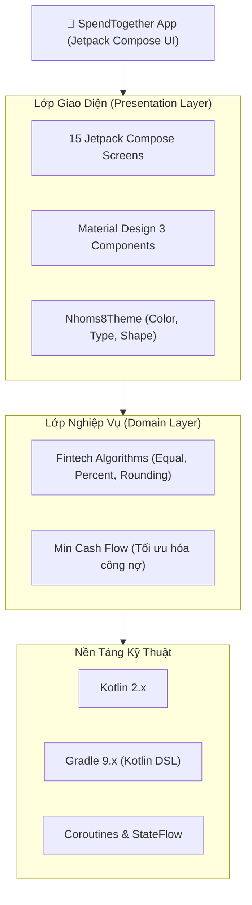

# 💰 SpendTogether - Quản lý Chi tiêu Cá nhân & Nhóm

> **Đồ án môn học:** Phát triển Ứng dụng (PTUD)  
> **Lớp:** D23CQCI01-N  
> **Nhóm thực hiện:** Nhóm 08  
> **Nền tảng:** Android (Kotlin, Jetpack Compose, Material 3)

---

## 📖 Giới thiệu Dự án

**SpendTogether** là ứng dụng di động hiện đại hỗ trợ người dùng quản lý tài chính cá nhân và tài chính nhóm một cách trực quan, minh bạch và chính xác. Ứng dụng giải quyết triệt để bài toán khó khăn khi đi ăn uống, du lịch hoặc sinh hoạt nhóm: **"Ai đã trả tiền?", "Ai nợ ai?", "Chia tiền thế nào cho công bằng?"** cùng thuật toán bù trừ công nợ thông minh giúp tối thiểu hóa số lần chuyển tiền.

Giao diện ứng dụng được phát triển 100% bằng **Jetpack Compose** kết hợp hệ thống thiết kế **Material 3**, đem lại trải nghiệm mượt mà, chuyển cảnh tinh tế cùng khả năng mở rộng kiến trúc cao.

---

## 👥 Danh Sách Thành Viên & Phân Công Nhiệm Vụ

| STT | Họ và Tên | Vai Trò | Tính Năng Phụ Trách | Màn Hình / Module Đảm Nhiệm |
| :---: | :--- | :---: | :--- | :--- |
| 1 | **Lê Văn Hùng** | **Trưởng nhóm** | **1. Xác thực người dùng (Auth)**<br>**2. Quản lý Thành viên (Members)** | `WelcomeScreen`, `OnboardingScreen(1-3)`, `LoginScreen`, `SignUpScreen`, `MembersScreen`, `EditMemberScreen` |
| 2 | **Lý Việt Linh** | **Thành viên** | **3. Quản lý Khoản Chi (Expense CRUD)**<br>**4. Quản lý Khoản Thu & Quỹ (Budget)** | `CreateExpenseScreen`, `HomeScreen` (Dashboard thu chi, hạn mức ngân sách) |
| 3 | **Nguyễn Phan Tấn Đạt** | **Thành viên** | **5. Tự Tính Chia Tiền (Splitting)**<br>**6. Quyết Toán & Nhắc Nợ (Settlement)** | `SplitBillScreen` (Chia đều, chia %), `SettlementScreen` (Thuật toán Min Cash Flow bù trừ công nợ) |
| 4 | **Lê Trung Bình** | **Thành viên** | **7. Lịch Sử & Bộ Lọc (History & Filter)**<br>**8. Báo Cáo & Biểu Đồ (Reports & Analytics)** | `TransactionHistoryScreen` (Bộ lọc ngày/danh mục/thành viên), `FinancialReportScreen`, `ProfileScreen` |

---

## ✨ Các Tính Năng Nổi Bật

### 1. Khám Phá & Xác Thực (Onboarding & Authentication)
- Chuỗi 3 màn hình Onboarding sinh động giải thích giá trị cốt lõi của ứng dụng.
- Đăng nhập, Đăng ký bảo mật, hỗ trợ ghi nhớ phiên đăng nhập.

### 2. Trang Chủ Thông Minh (Dashboard)
- Hiển thị số dư hiện tại, tổng thu, tổng chi tiêu trong tháng.
- Thẻ cảnh báo hạn mức ngân sách trực quan.
- Lối tắt thêm nhanh giao dịch và chia tiền nhóm.

### 3. Quản Lý Thành Viên & Nhóm Chi Tiêu
- Thêm, sửa, xóa thành viên nhóm dễ dàng.
- Theo dõi số dư công nợ của từng thành viên trong nhóm theo thời gian thực.

### 4. Nhập Khoản Chi Tiêu Hiện Đại
- Bàn phím số thiết kế riêng chuẩn tài chính, hỗ trợ nhập nhanh.
- Phân loại danh mục phong phú: Ăn uống, Di chuyển, Mua sắm, Hóa đơn,...
- Đính kèm hình ảnh hóa đơn và người trả tiền.

### 5. Chia Tiền Tự Động & Linh Hoạt (Split Bill)
- **Chia đều (Equally):** Tự động chia số tiền cho danh sách thành viên được chọn, xử lý số lẻ chính xác tới từng đồng.
- **Chia theo tỷ lệ % hoặc tùy chọn:** Linh hoạt theo nhu cầu thực tế của từng buổi tiệc.

### 6. Quyết Toán Nợ Thông Minh (Smart Debt Settlement)
- Áp dụng thuật toán **Min Cash Flow (Đồ thị bù trừ nợ)** để giảm thiểu tối đa số giao dịch cần chuyển tiền giữa các thành viên.
- Nút xác nhận trả nợ một chạm, ghi nhận trạng thái đã thanh toán.

### 7. Lịch Sử Giao Dịch & Bộ Lọc Đa Tiêu Chí
- Tìm kiếm nhanh giao dịch theo từ khóa.
- Lọc theo khoảng thời gian (Hôm nay, Tuần này, Tháng này, Tùy chọn).
- Lọc theo danh mục và thành viên liên quan.

### 8. Báo Cáo Tài Chính Trực Quan
- Biểu đồ phân bổ chi tiêu theo danh mục.
- So sánh chi tiêu giữa các tháng giúp người dùng điều chỉnh ngân sách hợp lý.

---

## 🛠️ Công Nghệ & Thư Viện Sử Dụng (Tech Stack)



* **Ngôn ngữ:** Kotlin 100%
* **UI Toolkit:** Jetpack Compose (Declarative UI)
* **Design System:** Material Design 3 (Material You)
* **Kiến trúc:** MVVM / Clean Architecture Pattern
* **Quản lý trạng thái:** `StateFlow`, `mutableStateOf`, `rememberSaveable`
* **Xử lý bất đồng bộ:** Kotlin Coroutines
* **Build System:** Gradle Kotlin DSL (`build.gradle.kts`) với Version Catalog (`libs.versions.toml`)
* **Target SDK:** 36 | **Min SDK:** 24 (Android 7.0+)

---

## 📂 Cấu Trúc Thư Mục Dự Án

```text
Nhoms8/
├── app/
│   ├── src/
│   │   ├── main/
│   │   │   ├── java/com/example/nhoms8/
│   │   │   │   ├── MainActivity.kt               # Entry point & Kết nối ViewModel StateFlow
│   │   │   │   ├── WelcomeScreen.kt              # Màn hình Splash / Chào mừng
│   │   │   │   ├── OnboardingScreen1.kt          # Onboarding giới thiệu tính năng 1
│   │   │   │   ├── OnboardingScreen2.kt          # Onboarding giới thiệu tính năng 2
│   │   │   │   ├── OnboardingScreen3.kt          # Onboarding giới thiệu tính năng 3
│   │   │   │   ├── LoginScreen.kt                # Màn hình Đăng nhập
│   │   │   │   ├── SignUpScreen.kt               # Màn hình Đăng ký
│   │   │   │   ├── HomeScreen.kt                 # Trang chủ Dashboard thu chi
│   │   │   │   ├── MembersScreen.kt              # Màn hình Danh sách Thành viên
│   │   │   │   ├── EditMemberScreen.kt           # Thêm / Chỉnh sửa Thành viên
│   │   │   │   ├── CreateExpenseScreen.kt        # Tạo khoản chi tiêu mới
│   │   │   │   ├── SplitBillScreen.kt            # Màn hình Chia tiền nhóm
│   │   │   │   ├── SettlementScreen.kt           # Quyết toán & Bù trừ công nợ
│   │   │   │   ├── TransactionHistoryScreen.kt   # Lịch sử giao dịch & Bộ lọc
│   │   │   │   ├── FinancialReportScreen.kt      # Báo cáo & Thống kê tài chính
│   │   │   │   ├── ProfileScreen.kt              # Trang cá nhân & Cài đặt
│   │   │   │   ├── algorithm/                    # FintechAlgorithm (Min Cash Flow & Chia tiền)
│   │   │   │   ├── data/                         # SpendTogetherRepository (Quản lý StateFlow)
│   │   │   │   ├── model/                        # Data Models (UserProfile, Budget, Transaction)
│   │   │   │   ├── viewmodel/                    # SpendTogetherViewModel & SpendTogetherUiState
│   │   │   │   └── ui/theme/                     # Color, Theme, Type Material 3
│   │   │   └── res/                              # Resources (Layouts, Drawables, Values)
│   │   └── test/                                 # Unit Tests (FintechAlgorithmTest)
│   └── build.gradle.kts                          # Cấu hình build module app
├── lib/                                          # Module JVM xử lý thuật toán
├── gradle/
│   ├── libs.versions.toml                        # Version Catalog quản lý thư viện tập trung
│   └── wrapper/                                  # Gradle Wrapper
├── AGENTS.md                                     # Kế hoạch điều phối AI Squad tăng năng suất
├── README.md                                     # Tài liệu tổng quan dự án
└── settings.gradle.kts                           # Khai báo cấu hình dự án
```

---

## 🚀 Hướng Dẫn Cài Đặt & Chạy Ứng Dụng

### Yêu Cầu Môi Trường
- **Android Studio:** Phiên bản Hedgehog, Iguana, Jellyfish, Koala hoặc mới hơn.
- **JDK:** Java 17 hoặc Java 21.
- **Android SDK:** Hỗ trợ Compile SDK 36, Target SDK 36, Min SDK 24.
- **Thiết bị:** Máy ảo Android Emulator (Android 7.0+) hoặc điện thoại thật bật chế độ *USB Debugging*.

### Các Bước Thực Hiện

1. **Clone repository về máy:**
   ```bash
   git clone https://github.com/Mr-Rabbit146452001/demo-app-PTUD.git
   cd demo-app-PTUD
   ```

2. **Mở dự án trong Android Studio:**
   - Chọn **File > Open...** và duyệt đến thư mục dự án vừa clone.
   - Chờ Android Studio đồng bộ Gradle (**Sync Project with Gradle Files**).

3. **Build & Run:**
   - Đảm bảo trên thanh công cụ chọn Run Configuration là **`app`** (biểu tượng robot Android).
   - Chọn thiết bị máy ảo hoặc điện thoại thật đã kết nối.
   - Nhấn nút **Run ▶️** (hoặc tổ hợp phím `Shift + F10`) để build và cài đặt ứng dụng.

---

## 📄 Bản Quyền & Giấy Phép
Dự án được thực hiện phục vụ mục đích học tập và nghiên cứu trong khuôn khổ môn học **Phát triển Ứng dụng (PTUD)** - Nhóm 08 (Lớp D23CQCI01-N).
